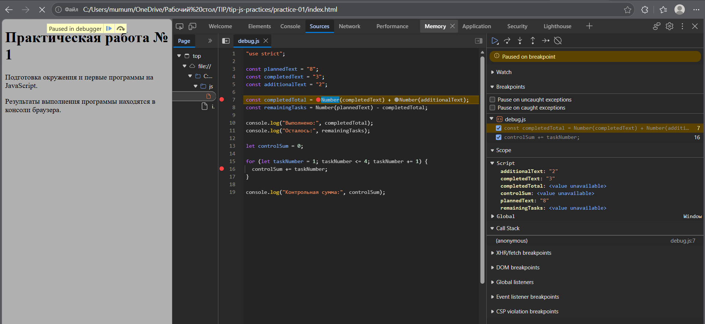
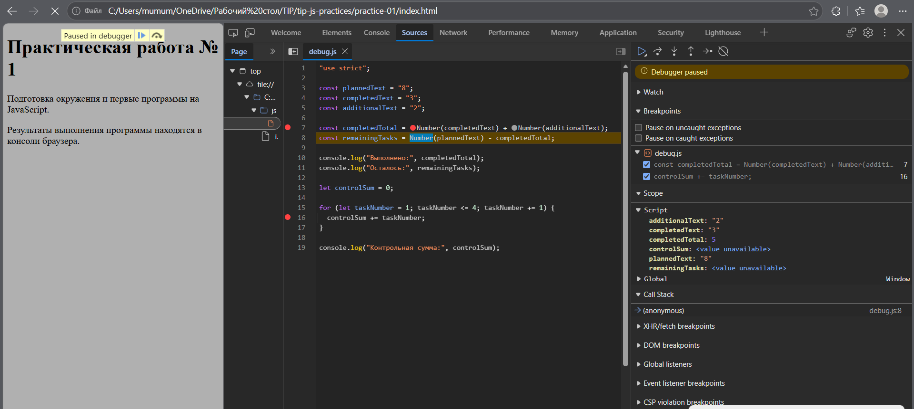

# Практическая работа № 1

**Тема:** Подготовка окружения и первые программы на JavaScript
**Дисциплина:** Технологии индустриального программирования

## 1. Автор и вариант

- **Имя:** [Новиков Роман]
- **Группа:** [ЭФБО-06-25]
- **Номер варианта:** [3]

## 2. Окружение

| Инструмент | Версия |
|---|---|
| ОС | [Windows 11 / macOS / Linux] |
| Node.js | [например, v24.21.0] |
| npm | [например, 11.19.0] |
| Git | [например, 2.55.0] |
| Браузер | [Chrome 130 / Edge 130] |

Версии получены командами:

```bash
node --version
npm --version
git --version
```

## 3. Запуск

Команды выполняются из корня репозитория `tip-js-practices`:

```bash
node practice-01/js/hello.js
node practice-01/js/types.js
node practice-01/js/progress.js
node practice-01/js/plan.js
node practice-01/js/debug.js
```

Для браузера: открыть `practice-01/index.html`, заменить путь в `<script src="...">` на нужный файл, сохранить, перезагрузить страницу, открыть Console (F12).

## 4. Задание 1. Один файл — две среды выполнения

**Что сделано:** создан `js/hello.js`, который выводит данные студента и проверяет тип `document`. Файл запущен через Node.js и через браузер.

**Вывод в Node.js:**

```
Студент: Новиков Роман
Группа: ЭФБО-06-25
Практическая работа: 1
JavaScript успешно запущен
Тип document: undefined
```

**Вывод в браузере (Console):**

```
Студент: Новиков Рооман
Группа: ЭФБО-06-25
Практическая работа: 1
JavaScript успешно запущен
Тип document: object
```

**Различие:** Node.js — среда вне браузера, не предоставляет DOM, поэтому `typeof document === "undefined"`. Браузер предоставляет объект `document` для работы со страницей, поэтому `typeof document === "object"`. Вывод появился **в консоли**, а не на HTML-странице.

## 5. Задание 2. Типы и преобразования

| № | Выражение | Ожидание до запуска | Фактическое значение | Тип результата | Объяснение |
|---|---|---|---|---|---|
| 1 | `"8" + 2` | `"82"` | `"82"` | string | Оператор `+` при наличии строки выполняет конкатенацию: `2` → `"2"` приклеивается к `"8"`. |
| 2 | `"8" - 2` | `6` | `6` | number | Оператор `-` работает только с числами: `"8"` неявно преобразуется в `8`. |
| 3 | `Number("8") + 2` | `10` | `10` | number | Явное преобразование строки в число, затем сложение. |
| 4 | `"12" > "3"` | `false` | `false` | boolean | Строки сравниваются лексикографически: `"1"` < `"3"`, значит `"12" < "3"`. |
| 5 | `12 === "12"` | `false` | `false` | boolean | Строгое равенство не преобразует типы: number ≠ string. |
| 6 | `Number("")` | `0` | `0` | number | Пустая строка при преобразовании даёт 0. Это не значит, что ввод корректен. |
| 7 | `Number("text")` | `NaN` | `NaN` | number | Непреобразуемая строка даёт NaN, при этом `typeof NaN === "number"`. |
| 8 | `Boolean("false")` | `true` | `true` | boolean | Любая непустая строка истинна, даже `"false"`. |
| 9 | `typeof null` | `"object"` | `"object"` | string | Историческая особенность JS: `null` — примитив, но `typeof` даёт `"object"`. Тип результата выражения — строка. |
| 10 | `typeof NaN` | `"number"` | `"number"` | string | `NaN` относится к типу number. Тип результата выражения — строка. |

Файл `types.js` запущен в Node.js и браузере, результаты совпадают.

## 6. Задания 3-4. Сводка выполнения задач и план по дням

**Данные варианта 2 для третьего задания:** `totalTasks = 15`, `completedTasks = 0`.

**Ожидаемый вывод для варианта:**

```
Всего задач: 15
Выполнено: 0
Осталось: 15
Прогресс: 0.0%
Статус: Не начато
```

**Таблица проверок:**

| Проверка | Входные данные | Ожидаемый результат | Фактический результат | Итог |
|---|---|---|---|---|
| Обычный случай (2 вариант) | 15, 0 | Осталось 15; 0.0%; Не начато | Совпало | Пройдено |
| Нули | 0, 0 | «Задач пока нет» | «Задач пока нет» | Пройдено |
| Не начато | 5, 0 | Осталось 5; 0.0%; Не начато | Совпало | Пройдено |
| Завершено | 5, 5 | Осталось 0; 100.0%; Завершено | Совпало | Пройдено |
| Больше выполнено | 5, 6 | Ошибка | Ошибка | Пройдено |
| Отрицательное | -1, 0 | Ошибка | Ошибка | Пройдено |
| Дробное | 5, 2.5 | Ошибка | Ошибка | Пройдено |
| Строка | "5", 2 | Ошибка | Ошибка | Пройдено |
| Верхняя граница | 1001, 0 | Ошибка | Ошибка | Пройдено |
| NaN | NaN, 0 | Ошибка | Ошибка | Пройдено |

После проверок возвращены данные варианта.

**Данные варианта 2 для четвёртого задания:** `totalTasks = 15`, `completedTasks = 0`, `dailyLimit = 4`.

**Ожидаемый вывод для варианта:**

```
Осталось задач: 15
День 1: выполнено 4, осталось 11
День 2: выполнено 4, осталось 7
День 3: выполнено 4, осталось 3
День 4: выполнено 3, осталось 0
Потребуется дней: 4
```

**Таблица проверок:**

| Проверка | Входные данные | Ожидаемый результат | Фактический результат | Итог |
|---|---|---|---|---|
| Обычный случай (2 вариант) | 15, 0, 4 | 4 дня по 4 задачи | Совпало | Пройдено |
| Ровное деление | 10, 4, 3 | 2 дня по 3 задачи | Совпало | Пройдено |
| Лимит больше остатка | 5, 3, 10 | 1 день, 2 задачи | Совпало | Пройдено |
| Всё выполнено | 5, 5, 2 | 0 дней, цикл не запускается | Совпало | Пройдено |
| Нули | 0, 0, 2 | 0 дней | Совпало | Пройдено |
| Лимит 0 | 5, 2, 0 | Ошибка, цикл не запускается | Ошибка | Пройдено |
| Лимит дробный | 5, 2, 1.5 | Ошибка | Ошибка | Пройдено |
| Выполнено больше | 5, 6, 2 | Ошибка | Ошибка | Пройдено |
| Лимит строка | 5, 2, "2" | Ошибка | Ошибка | Пройдено |
| Лимит 1001 | 5, 2, 1001 | Ошибка | Ошибка | Пройдено |

## 7. Отладка

**Исходный вывод (с ошибками):**

```
Выполнено: 32
Осталось: -24
Контрольная сумма: 6
```

**Вывод после исправления:**

```
Выполнено: 5
Осталось: 3
Контрольная сумма: 10
```

**Таблица ошибок:**

| Ошибка | Что наблюдалось | Причина | Исправление | Результат |
|---|---|---|---|---|
| Обработка количества задач | `Выполнено: 32`, `Осталось: -24` | Оператор `+` для строк выполнил конкатенацию: `"3" + "2" = "32"`. При вычитании `"32"` неявно преобразовалось в число, дав `8 - 32 = -24`. | Добавлено явное `Number()` вокруг строк. | `Выполнено: 5`, `Осталось: 3` |
| Граница цикла | `Контрольная сумма: 6` | Условие `taskNumber < 4` останавливает цикл до 4, сумма `1+2+3 = 6`. | Условие изменено на `taskNumber <= 4`. | `Контрольная сумма: 10` |

**Скриншоты отладки:**





На скриншотах видна строка остановки и значения переменных в панели Scope.

## 8. Вывод

В ходе работы освоены: запуск JavaScript в Node.js и браузере, работа с типами данных, явное и неявное преобразование, условия, циклы, отладка через DevTools, базовые команды Git.

Наиболее показательная ошибка — неявное преобразование типов при сложении строк: `"3" + "2"` дало `"32"` вместо `5`. Это доказывает необходимость явного `Number()` и проверки типов входных данных.

## 9. Контрольные вопросы (краткие ответы)

1. **JavaScript vs Node.js:** JS — язык, Node.js — среда выполнения вне браузера. `document` доступен только в браузере.
2. **const vs let:** `const` — без переприсваивания, `let` — с переприсваиванием. `const` запрещает переприсваивание, но не делает объект неизменяемым.
3. **12 vs "12":** разные типы: number и string.
4. **Строка + число:** оператор `+` выполняет конкатенацию, а не сложение.
5. **=== vs ==:** `===` не преобразует типы, `==` преобразует.
6. **Number(""):** даёт 0, но пустая строка — некорректный ввод.
7. **typeof number:** недостаточно, потому что `typeof NaN === "number"`.
8. **Порядок обработки:** проверка типа → целочисленности → диапазона → случай «нет задач» → расчёт процента.
9. **Конец цикла:** `remainingTasks` становится 0. Без проверки `dailyLimit` возможен бесконечный цикл.
10. **Последняя итерация:** остаток меньше `dailyLimit`, решается через `Math.min()`.
11. **Точка останова:** позволяет исследовать переменные в реальном времени и пошагово выполнять код.
12. **Сохранение / коммит / push:** диск → локальная история Git → удалённый репозиторий GitHub.