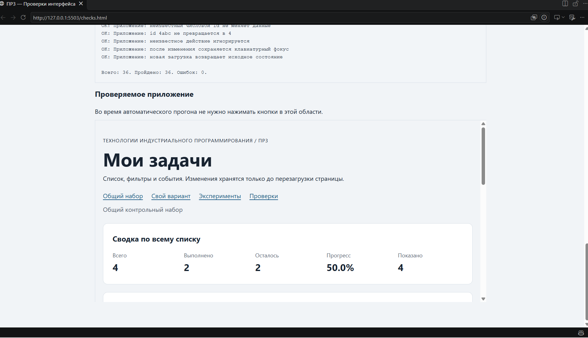

# Практическая работа № 3. Работа с DOM и событиями

## Данные работы

| Поле | Значение |
|---|---|
| Имя | Новиков Роман |
| Группа | ЭФБО-06-25 |
| Вариант из ПР2 | 2 |
| Node.js | v24.21.0 |
| Браузер | Microsoft Edge версия 157.0.4341.42 |
| Операционная система | Windows 11 |

## Запуск

Рабочая папка: `practice-03` внутри личного репозитория.

```bash
npm run check:service
npm start
```

Устанавливать зависимости через `npm install` не требуется. Для PowerShell при блокировке `npm.ps1` доступны `npm.cmd` и прямые команды `node`.

```text
http://127.0.0.1:5503/
http://127.0.0.1:5503/index.html?dataset=variant
http://127.0.0.1:5503/examples/dom-events.html
http://127.0.0.1:5503/checks.html
```

Остановка сервера: `Ctrl+C`. Если выбран другой порт, указать фактическую команду и адрес.

## Что перенесено из ПР2

`task-service.js` и `data.js` скопированы из `practice-02/src/` командами:

```bush
Copy-Item .\practice-02\src\task-service.js .\practice-03\src\task-service.js
Copy-Item .\practice-02\src\data.js .\practice-03\src\data.js
```

Результат `npm run check:service`:

```text
> tip-js-practice-03@1.0.0 check:service
> node checks/service.checks.js

OK: 01. Создание задачи с явным приоритетом
OK: 02. Приоритет по умолчанию
OK: 03. Удаление краевых пробелов без изменения внутренних
OK: 04. Граничные длины названия и положительный безопасный id
OK: 05. Некорректные названия при создании
OK: 06. Некорректные идентификаторы при создании
OK: 07. Все допустимые приоритеты и отклонение недопустимых
OK: 08. Каждый вызов createTask возвращает новый объект
OK: 09. Поиск по id, а не по индексу
OK: 10. Отсутствующая задача и пустой массив при поиске
OK: 11. Поиск не преобразует строковый id в число
OK: 12. Получение невыполненных задач
OK: 13. Пустой список, все выполнены и все не выполнены
OK: 14. Названия в исходном порядке и пустой список
OK: 15. Сводка по общему набору
OK: 16. Сводка по пустому списку
OK: 17. Сводка: ничего не выполнено и выполнено всё
OK: 18. Процент остаётся числом без предварительного округления
OK: 19. Добавление в конец без изменения входного массива
OK: 20. Добавление в пустой список с приоритетом по умолчанию
OK: 21. Повторяющийся id отклоняется
OK: 22. Добавление не обходит проверки createTask
OK: 23. Изменение completed в обе стороны
OK: 24. completed принимает только boolean
OK: 25. Некорректный или отсутствующий id при изменении статуса
OK: 26. Повторная установка статуса создаёт новый результат
OK: 27. Переименование сохраняет остальные поля
OK: 28. Проверки названия при переименовании
OK: 29. Некорректный или отсутствующий id при переименовании
OK: 30. Удаление по id с сохранением порядка
OK: 31. Удаление единственной записи
OK: 32. Некорректный, отсутствующий id и удаление из пустого списка
OK: 33. Входные объекты не изменяются ни одной операцией
OK: 34. Общий сценарий и все промежуточные сводки
OK: 35. Работа с другим набором, без зависимости от demoTasks

Проверок пройдено: 35; не пройдено: 0.
```

## Эксперименты

| № | До запуска: прогноз | После запуска: результат | Объяснение |
|---:|---|---|---|
| 1. Отсутствующий элемент и коллекция | `querySelector` вернёт `null`; `querySelectorAll` вернёт пустой `NodeList` длиной 0; обращение к свойству `null` вызовет `TypeError`. | `null`, `NodeList(0)`, `TypeError` при попытке записи `missing.textContent`. | Поиск по CSS-селектору не создаёт элемент. Пустая коллекция - это валидный объект, а `null` - нет. |
| 2. dataset и числовой id | `dataset.taskId` вернёт строку "4"; после `Number()` — число 4. | Строка "4", затем число 4, `typeof` меняется с `string` на `number`. | `dataset` всегда хранит строки. В сервис ПР2 передаётся число, поэтому нужен `Number` и проверка `Number.isSafeInteger`. |
| 3. Статический NodeList | `initialItems.length` не увеличится при добавлении DOM-узла; новый `querySelectorAll` вернёт коллекцию большего размера. | Длина сохранённого массива не изменилась; новый запрос вернул на 2 элемента больше (после двух нажатий). | `querySelectorAll` возвращает статический `NodeList` — это снимок на момент вызова, а не живая коллекция. |
| 4. Строка с HTML-разметкой | На странице будет видна буквальная строка `<strong>…</strong>`, элемент `strong` внутри заголовка не появится. | Отображается текст с угловыми скобками; `title.querySelector("strong") === null`. | `textContent` трактует значение как текст. `innerHTML` разобрал бы его как разметку — для пользовательских названий это не нужно и небезопасно. |
| 5. Распространение события | Порядок в журнале: захват → цель → всплытие. `event.target` = вложенный `span`, `event.currentTarget` = кнопка на фазе цели и выше. | ...

 | Событие `click` проходит от `window` вниз (фаза 1), затем на цели (фаза 2), затем вверх (фаза 3). Обработчик на кнопке получает нажатие по `span` именно за счёт всплытия. Поэтому в `handleTaskListClick` используется `closest`, а не прямое чтение `dataset` у `event.target`. |

## Организация кода

- `task-service.js` - прикладные функции ПР2 (`findTaskById`, `getTaskStats`, `setTaskCompleted`, `removeTask`). DOM не трогает.

- `task-selectors.js` - `getVisibleTasks(tasks, filter)`: возвращает новый массив по фильтру `all` / `pending` / `completed`. Входные задачи не изменяет.

- `task-view.js` - `createTaskElement`, `renderTaskList`, `renderSummary`, `renderEmptyState`. Создаёт карточки через `createElement` и `textContent`, заменяет содержимое `ul#task-list`через `replaceChildren`, считает сводку через `getTaskStats`, различает два вида пустого состояния.

- `main.js` - состояние (`currentTasks` хранит полный список, `currentFilter` - текущий фильтр). Обработчики `handleTaskListClick` и `handleFilterClick` навешены на контейнеры `elements.list` и `elements.filters` один раз. Событие распознаётся через `closest`, id приводится к числу и проверяется, изменение данных идёт через сервис ПР2, после успеха вызывается `renderApp()` и `restoreTaskFocus`.

Полный список хранится в `currentTasks` (main.js), фильтр — в `currentFilter` (main.js). Обработка события — в `main.js`. Сводка вычисляется в `renderSummary` (task-view.js) через `getTaskStats` по полному `currentTasks`, а счётчик «Показано» — по длине видимой выборки.

## Общий сценарий

Ожидания находятся в разделе 6.5 методички. Ниже записываются фактические результаты запуска.

| Шаг | Видимые id | Всего | Выполнено | Осталось | Прогресс | Показано | Сообщение | Совпало с ожиданием |
|---:|---|---|---|---|---|---|---|---|
| 0 | [1, 4, 7, 10] | 4 | 2 | 2 | 50.0% | 4 | - | Да |
| 1 | [4, 7] | 4 | 2 | 2 | 50.0% | 2 | - | Да |
| 2 | [7] | 4 | 3 | 1 | 75.0% | 1 | - | Да |
| 3 | [1, 4, 7, 10] | 4 | 3 | 1 | 75.0% | 4 | - | Да |
| 4 | [1, 4, 10] | 3 | 3 | 0 | 100.0% | 3 | - | Да |
| 5 | [] | 3 | 3 | 0 | 100.0% | 0 | Нет задач по выбранному фильтру. | Да |
| 6 | [1, 4, 10] | 3 | 2 | 1 | 66.7% | 3 | - | Да |
| 7 | [] | 0 | 0 | 0 | 0.0% | 0 | Список задач пуст. | Да |

После перезагрузки: возвращается шаг 0 - сохранения в ПР3 нет, это ожидаемо.

## Индивидуальный вариант

Тема: «Подготовка выступления». Исходные шесть задач (`variantTasks`, вариант 2):

| id | Название | completed | priority |
|---:|---|---|---|
| 11 | Определить тему выступления | true | high |
| 23 | Собрать материалы | false | medium |
| 37 | Подготовить черновик | false | low |
| 41 | Сделать презентацию | false | medium |
| 58 | Отрепетировать | false | high |
| 64 | Проверить оборудование | false | low |

| Этап | Всего | Выполнено | Осталось | Прогресс | Видимые id |
|---|---|---|---|---|---|
| До действий | 6 | 1 | 5 | 16.7% | [11, 23, 37, 41, 58, 64] |
| После переключения 23 | 6 | 2 | 4 | 33.3% | [11, 23, 37, 41, 58, 64] |
| После удаления 37 | 5 | 2 | 3 | 40.0% | [11, 23, 41, 58, 64] |
| Итог, фильтр «В работе» | 5 | 2 | 3 | 40.0% | [41, 58, 64] |
| Итог, фильтр «Выполненные» | 5 | 2 | 3 | 40.0% | [11, 23] |

Итоговый прогресс `40.0%` совпадает с ожидаемым значением из таблицы методички для варианта 2.

## Протокол проверки сервиса

Реальный вывод `npm run check:service`:

```text
PS C:\Users\mumum\OneDrive\Рабочий стол\TIP\tip-js-practices\practice-03> npm run check:service

> tip-js-practice-03@1.0.0 check:service
> node checks/service.checks.js

OK: 01. Создание задачи с явным приоритетом
OK: 02. Приоритет по умолчанию
OK: 03. Удаление краевых пробелов без изменения внутренних
OK: 04. Граничные длины названия и положительный безопасный id
OK: 05. Некорректные названия при создании
OK: 06. Некорректные идентификаторы при создании
OK: 07. Все допустимые приоритеты и отклонение недопустимых
OK: 08. Каждый вызов createTask возвращает новый объект
OK: 09. Поиск по id, а не по индексу
OK: 10. Отсутствующая задача и пустой массив при поиске
OK: 11. Поиск не преобразует строковый id в число
OK: 12. Получение невыполненных задач
OK: 13. Пустой список, все выполнены и все не выполнены
OK: 14. Названия в исходном порядке и пустой список
OK: 15. Сводка по общему набору
OK: 16. Сводка по пустому списку
OK: 17. Сводка: ничего не выполнено и выполнено всё
OK: 18. Процент остаётся числом без предварительного округления
OK: 19. Добавление в конец без изменения входного массива
OK: 20. Добавление в пустой список с приоритетом по умолчанию
OK: 21. Повторяющийся id отклоняется
OK: 22. Добавление не обходит проверки createTask
OK: 23. Изменение completed в обе стороны
OK: 24. completed принимает только boolean
OK: 25. Некорректный или отсутствующий id при изменении статуса
OK: 26. Повторная установка статуса создаёт новый результат
OK: 27. Переименование сохраняет остальные поля
OK: 28. Проверки названия при переименовании
OK: 29. Некорректный или отсутствующий id при переименовании
OK: 30. Удаление по id с сохранением порядка
OK: 31. Удаление единственной записи
OK: 32. Некорректный, отсутствующий id и удаление из пустого списка
OK: 33. Входные объекты не изменяются ни одной операцией
OK: 34. Общий сценарий и все промежуточные сводки
OK: 35. Работа с другим набором, без зависимости от demoTasks

Проверок пройдено: 35; не пройдено: 0.
```

## Протокол браузерных проверок

Реальный текст из блока «Текстовый протокол» на `checks.html`:

```text
OK: Фильтр all возвращает новый массив в исходном порядке
OK: Фильтр pending выбирает невыполненные задачи
OK: Фильтр completed выбирает выполненные задачи
OK: Все три фильтра работают с пустым списком
OK: Фильтрация не меняет входные записи и их порядок
OK: Карточка — li.task-card с числовым id в dataset
OK: Статус невыполненной карточки и aria-pressed согласованы
OK: Статус выполненной карточки и aria-pressed согласованы
OK: В карточке две обычные кнопки с вложенными подписями
OK: Все приоритеты отображаются по установленному словарю
OK: Название с разметкой отображается текстом
OK: Отрисовка списка создаёт карточки в исходном порядке
OK: Повторная отрисовка не накапливает карточки
OK: Контейнер списка и его обработчик сохраняются
OK: Отрисовка пустого массива очищает прежние карточки
OK: Сводка считается по всему списку, отдельно выводится Показано
OK: Пустая сводка не содержит NaN и Infinity
OK: Сообщение для полностью пустого списка
OK: Сообщение для пустого результата фильтра
OK: Появление карточек скрывает прежнее пустое состояние
OK: Приложение: начальный набор и сводка
OK: Приложение: фильтр срабатывает по клику на вложенный span
OK: Приложение: активный фильтр отмечен классом и aria-pressed
OK: Приложение: фильтрация не удаляет скрытые задачи
OK: Приложение: переключение по id, а не индексу массива
OK: Приложение: выполненная задача исчезает из фильтра В работе
OK: Приложение: удаление изменяет данные, а не только DOM
OK: Приложение: клик по названию не изменяет данные
OK: Приложение: после перерисовок одно нажатие — одно изменение
OK: Приложение: удаление всех записей и нулевая сводка
OK: Приложение: нет совпадений — не то же самое, что нет задач
OK: Приложение: неизвестный числовой id не меняет данные
OK: Приложение: id 4abc не превращается в 4
OK: Приложение: неизвестное действие игнорируется
OK: Приложение: после изменения сохраняется клавиатурный фокус
OK: Приложение: новая загрузка возвращает исходное состояние

Всего: 36. Пройдено: 36. Ошибок: 0.
```

## Собственные проверки

| № | Исходное состояние и действия | Ожидаемый результат | Фактический результат | Итог |
|---:|---|---|---|---|
| 1 | Граничное: единственная задача `{id:5,title:"A",completed:false,priority:"low"}`; удалить её через `removeTask`. | `{ok:true, tasks:[]}`, исходный массив не изменён. | `tasks` пуст, исходный массив длины 1 сохранён. | Пройдено |
| 2 | Граничное: все задачи выполнены; `getVisibleTasks(tasks,"pending")`. | `[]`, при этом `getTaskStats` даёт `pending:0`, `progress:100`. | `[]`; сводка `100`. | Пройдено |
| 3 | Событие/повторная отрисовка: фильтр `pending`, затем двойной клик по кнопке статуса `id=4` в `iframe`. | После первого — id 4 исчезает из выборки; после второго (после возврата в «Все») — статус снова `В работе`, сводка `50.0%`, обработчик срабатывает ровно один раз. | Совпадает; накопления изменений нет. | Пройдено |

## Отладка и клавиатура

- Точка останова в `main.js`, строка чтения `dataset.taskId`. Значения: `event.target` — `span.action-label`, `event.currentTarget` — `ul#task-list`, `dataset.taskId` — `"4"` (`string`), после `Number(...)` — `4` (`number`), `Number.isSafeInteger(4)` — `true`, действие — `"toggle"`, результат сервиса — `{ok:true, tasks:[…]}` с `completed:true` у записи 4.
- Проверка Tab: фокус последовательно проходит фильтры и кнопки карточек; Enter и Space активируют нативную `<button>`, действие выполняется один раз.
- После изменения статуса фокус возвращается на кнопку `toggle` той же карточки (`restoreTaskFocus`); после удаления карточка исчезает — фокус переходит на активный фильтр.
- Отказ для `777` и `4abc`: в панели Elements временно меняем `data-task-id`; после клика в `#operation-message` появляется «Некорректный идентификатор задачи.» или «Задача не найдена.», данные не меняются, выбор фильтра пересоздаёт карточки из массива и очищает сообщение.

## Вид приложения



## Дополнительное задание

Дополнительное задание не выполнялось.

## Вывод

В ходе работы прикладные функции ПР2 (`task-service.js`, `data.js`) были подключены к браузерному интерфейсу. Реализованы: отбор по фильтру (`getVisibleTasks`), построение карточки и повторная отрисовка списка (`createTaskElement`, `renderTaskList`), сводка и два вида пустого состояния (`renderSummary`, `renderEmptyState`), а также делегирование кликов на контейнерах (`handleTaskListClick`, `handleFilterClick`) с проверкой `id` и вызовом сервиса ПР2.

Ключевое различие, отработанное в работе: изменение данных (`currentTasks = result.tasks`) и изменение DOM (`renderApp`) — разные шаги. Удаление только DOM-узла или замена полного массива видимой выборкой нарушают контракт приложения; поэтому фильтр не удаляет записи, а `currentTasks` всегда хранит полный список. Обработчики навешаны один раз на контейнеры, что исключает накопление реакций после перерисовок. Разметка в названиях выводится как текст через `textContent`. Проверки сервиса (35/35) и браузерные сценарии (`checks.html`) подтверждают поведение; при защите дополнительно демонстрируются отладка события, работа с клавиатурой и граничные случаи `777` и `4abc`.